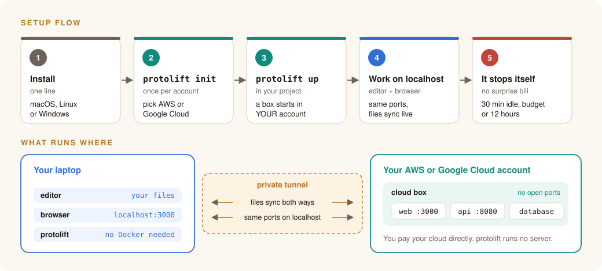
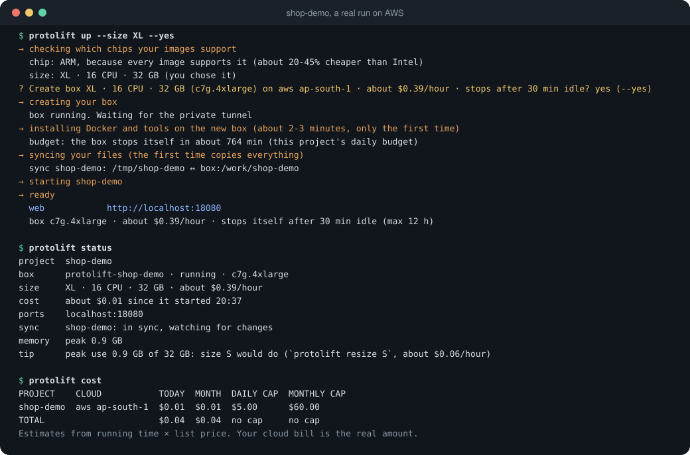
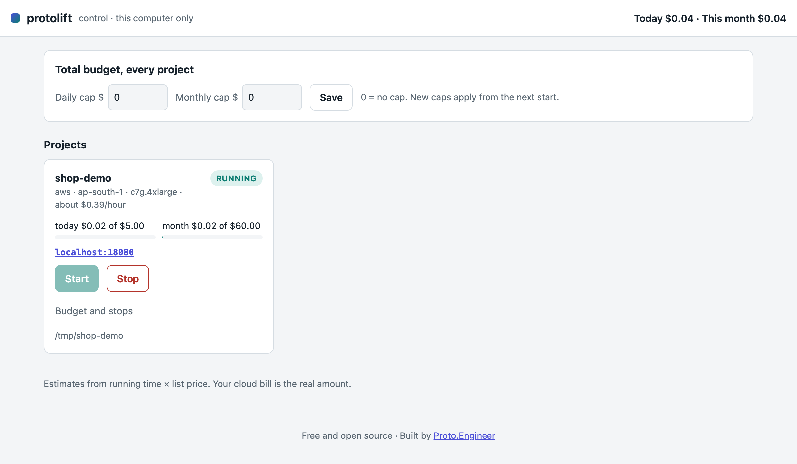

# protolift

**Run your whole dev stack in your own AWS or Google Cloud account, and use it on `localhost` as if it ran on your laptop.**

Your laptop is too slow or too full for Docker and your services? protolift starts a cloud box in
**your** AWS or Google Cloud account, keeps your files in sync both ways, runs your stack there, and mirrors every
port back to the same port on your laptop. Your editor, browser and tools do not change.

<p align="center"></p>

- **Your account, your bill.** protolift runs no server. It uses your own cloud login and you pay the cloud directly.
- **Any cloud, plug-in style.** AWS and Google Cloud today (`--cloud aws|gcp`). Each cloud is one adapter.
- **No project changes.** It reads your existing `compose.yaml` and starts your services with the same port numbers.
- **Live sync.** A save on the laptop reaches the box in well under a second. In our test, a page change was
  visible on `localhost` 0.22 s after saving.
- **Cost control.** Daily and monthly budgets per project and in total. `up` refuses to go over, and the box
  stops itself when its budget, 30 idle minutes or 12 hours run out, even with your laptop closed.
  `protolift cost` and the local screen (`protolift ui`) show spend. `protolift down` deletes everything it made.
- **AI-ready.** An MCP server (`protolift mcp`), an Agent Skill and `--json` output let AI agents use it safely:
  anything that costs money or deletes needs an explicit yes.
- **Private.** The box has no inbound network rules. Access goes only through AWS Systems Manager, with a
  single-use SSH key per connection.
- **Any OS.** macOS, Linux and Windows. One program, no Docker on the laptop.

## Install

macOS / Linux:

```sh
curl -fsSL https://raw.githubusercontent.com/Prabhudas111/protolift/main/install.sh | sh
```

Windows (PowerShell):

```powershell
irm https://raw.githubusercontent.com/Prabhudas111/protolift/main/install.ps1 | iex
```

Or with Go: `go install github.com/Prabhudas111/protolift/cmd/protolift@latest`

You also need, once:

- the OpenSSH client (built into macOS, Linux and Windows 10+),
- **AWS:** a login (`aws configure sso`) and the
  [Session Manager plugin](https://docs.aws.amazon.com/systems-manager/latest/userguide/session-manager-working-with-install-plugin.html)
  (`brew install --cask session-manager-plugin` on macOS),
- **Google Cloud:** the [gcloud CLI](https://cloud.google.com/sdk/docs/install) and a login (`gcloud auth login`).

## Use

```sh
protolift init                  # once per account and region (safe to run again)
cd my-app
protolift up                    # create or wake the box, sync, start, mirror ports

protolift init --cloud gcp --project my-project --region us-central1   # the same on Google Cloud
protolift up --cloud gcp
```

`up` prints your links (`http://localhost:3000` and so on) and keeps the ports mirrored until you press
Ctrl-C. The box keeps running after that and stops itself when idle.

<p align="center"></p>

| Command | What it does |
|---|---|
| `protolift init` | Sets up your AWS account once: an access role and a firewall group with no inbound rules. |
| `protolift up` | Starts or wakes the box, syncs files, runs your stack, mirrors its ports. |
| `protolift status` | Box, size, cost so far, sync state, ports, and a size tip from real memory use. |
| `protolift list` | Every protolift box in this region. |
| `protolift stop` | Stops the box. Files and data stay on its disk. |
| `protolift resize S\|M\|L\|XL` | Changes the box size, keeping the disk. |
| `protolift down` | Deletes the box, its disk and its alarm. Nothing is left in AWS. |
| `protolift uninstall` | Removes the one-time setup from `init`. |
| `protolift config` | Shows (and creates) this project's settings file, kept **outside** your repo. |
| `protolift cost` | Spend today and this month, per project and in total. |
| `protolift budget --daily 5 --monthly 60 [--all]` | Sets spending caps for this project, or all projects. |
| `protolift ui` | Opens the local control screen: boxes, spend, budgets, start/stop. This computer only. |
| `protolift mcp` | MCP server for AI agents (`--http` for a local URL). See [docs/agents.md](docs/agents.md). |
| `protolift ssh` | Opens a terminal on the box. |
| `protolift logs [service]` | Follows logs on the box. |

### The control screen

`protolift ui` opens this page on your computer only. It shows each box, its spend against your caps, and
start and stop buttons.

<p align="center"></p>

### Box sizes

protolift suggests a size from your stack and asks, with the price, before creating anything.

| Size | CPU | Memory | AWS (ARM / Intel) | Google Cloud (ARM / Intel) |
|---|---|---|---|---|
| S | 2 | 8 GB | m7g.large / m7i.large | t2a-standard-2 / n2-standard-2 |
| M | 4 | 16 GB | m7g.xlarge / m7i.xlarge | t2a-standard-4 / n2-standard-4 |
| L | 8 | 32 GB | m7g.2xlarge / m7i.2xlarge | t2a-standard-8 / n2-standard-8 |
| XL | 16 | 32 GB+ | c7g.4xlarge / c7i.4xlarge | t2a-standard-16 / n2-standard-16 |

ARM is chosen when every image in your stack supports it and the region offers it, because it costs less.
Otherwise Intel is used. See [docs/cost.md](docs/cost.md) for budgets and stops.

### Stacks without a compose file

Run `protolift config` and describe each folder. Folders can live side by side, for example an API and a web app:

```toml
[[folder]]
path = "."
setup = "npm ci"
run = "npm run dev"
ports = [3000]

[[folder]]
path = "../api"
setup = "go mod download"
run = "make dev"
ports = [8080]
```

### Your `.env` files

`.env` files at the top of each folder are copied **laptop → box only**, owner-only, and their contents are
never printed. Changes are copied while `up` runs. Use `--no-env` to skip them.

## How it works, and the tech inside

protolift is built on AWS Systems Manager tunnels, OpenSSH, [Mutagen](https://github.com/mutagen-io/mutagen)
file sync and Docker Compose. Read [ARCHITECTURE.md](ARCHITECTURE.md) for the design, and
[docs/](docs/) for the details.

Want to learn how pieces like these work: tunnels, networking, cloud, system design? That is what
**[Proto.Engineer](https://www.proto-engineer.com)** teaches.

## Cloud permissions

- AWS: [docs/iam/init-admin.json](docs/iam/init-admin.json) (one time) and [docs/iam/daily-user.json](docs/iam/daily-user.json) (every day).
- Google Cloud: [docs/iam/gcp.md](docs/iam/gcp.md).

If your AWS organization limits box types or regions (a service control policy), protolift says so. Ask your
admin which types are allowed and pick a matching `--size`.

## Troubleshooting

See [docs/troubleshooting.md](docs/troubleshooting.md). Add `--debug` to any command for the full error.

## Contributions

protolift does not accept outside code contributions. Issues (bugs, ideas) are welcome. See [CONTRIBUTING.md](CONTRIBUTING.md).

## License

Apache License 2.0. See [LICENSE](LICENSE) and [NOTICE](NOTICE).
The names "protolift" and "Proto.Engineer" are not licensed. See [TRADEMARKS.md](TRADEMARKS.md).

Built and maintained by **Prabhudas Avanigadda** · [Proto.Engineer](https://www.proto-engineer.com)
